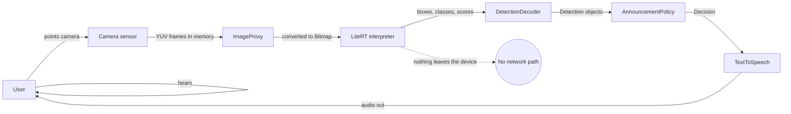

# Threat Model and Privacy Design — Disha Voice

**Date:** 2026-10-20
**Scope:** the P0 Android prototype. Severity is relative to this project, not to enterprise
systems. Each threat states whether it is **mitigated**, **partially mitigated**, or **open**.

---

## 1. What is actually sensitive here

This is an accessibility tool for people who cannot see their own surroundings. That changes
the threat model in one crucial way:

> **The camera view is the user's environment.** It may contain their home layout, their
> medication, their mail, their documents, the faces and clothing of bystanders, and — because a
> blind user's surroundings often identify them — information about where they live, what they
> look like, and who they live with.

Compare a photo app: a user chooses to take a picture. Here the camera is pointed at
*everything*, continuously, by someone who cannot check what is in frame.

Additional sensitive assets:

| Asset | Why it matters |
|---|---|
| The user's surroundings | Location, possessions, people, routines |
| Bystanders' faces and clothing | Biometric data about people who never consented |
| The audio environment | TTS output announces what is in the room, to anyone nearby |
| The device itself | A screen-reader user's phone is a gateway to their accounts |
| The user's own safety | A false "nothing detected" could be misread as "all clear" |

---

## 2. Threat actors

| Actor | Capability | Motivation |
|---|---|---|
| A curious bystander | Physical proximity, can overhear TTS | Curiosity, nosiness |
| A person in the user's home | Knows the app exists | Information about what the user owns, or what they cannot see |
| A co-resident malicious app | On the same device | Reads files, reads screen content, requests permissions |
| A network attacker | On the same Wi-Fi | Sees traffic (there should be none) |
| A dependency supply-chain attacker | Controls a build dependency | Code execution in the app, model substitution |
| A tampered model file | Replaces the bundled asset | Silently mislabels objects — the most dangerous failure |
| A future cloud captioner | Receives user imagery | Retains bystander data; commercial reuse |
| An attacker with the release key | Signs a malicious update | Full control of installed apps |
| A CI compromise | Steals repository secrets | Publishes poisoned releases |

---

## 3. Threat table

| # | Threat | Asset | Attack | Likelihood | Impact | Mitigation | Status | Residual risk |
|---|---|---|---|---|---|---|---|---|
| T1 | Frame persistence | User's surroundings | App writes frames to internal/external storage | Low (not written by our code) | High | **No code path writes images.** Frames live in an `ImageProxy`, are converted to a bitmap, and the bitmap is recycled. No `WRITE_EXTERNAL_STORAGE`; no `MediaStore` use. | Mitigated by construction | A future crash dump could capture a bitmap — see T4 |
| T2 | Screenshots / recents | Screen content | The camera preview appears in the task-switcher | **Medium — this is real** | Medium | Not yet addressed. Consider `FLAG_SECURE` on the activity to keep the preview out of screenshots and recents. | **Open** | Low-medium: a bystander with the phone can screenshot the view |
| T3 | Camera indicator | User's awareness | A user does not notice the camera is on | Low | High | The system camera indicator is shown by the OS; the app's own state is spoken and visible ("Camera started" / "Camera stopped") and a large stop control is always present. | Partially mitigated | A screen-reader user must trust the spoken state |
| T4 | Crash dump leakage | User's surroundings | A crash while a frame is in memory writes a heap dump | Low | Medium | R8 in release builds; no explicit `logcat` of frames; the app never logs image data. | Partial | A system-level crash reporter could capture memory. No third-party crash SDK is included, which removes the usual vector. |
| T5 | logcat leakage | Detection results | Debug logging of frame data or object identities | Low | Medium | No frame data is logged. `Log.e` is used only for load/inference failure messages. | Mitigated | Debug builds are more verbose; users should not ship debug builds |
| T6 | Bystander imagery to a cloud | Bystanders' faces | A future "scene description" feature uploads frames | Low today, **High if built carelessly** | High | No such feature exists. No `INTERNET` permission is declared, so **the app literally cannot upload anything**. Any future networked feature must be opt-in, must disclose the payload, and must re-open the permission and consent analysis. | Mitigated by absence | The temptation to add it later — tracked by design review, not code |
| T7 | Model tampering | Detection correctness | The bundled `.tflite` is replaced with a mislabelling model | Low (requires device write access) | **High — silent** | The asset's SHA-256 is recorded in `RESEARCH/model-and-data-audit.md` and `THIRD_PARTY_NOTICES.md`. A wrong model produces plausible but wrong speech, which is exactly the dangerous failure. | **Partial — no runtime verification** | Consider verifying the asset digest at first launch in release builds |
| T8 | Dependency compromise | Everything | A malicious version of an AndroidX/LiteRT artifact | Low | High | Dependencies are pinned to exact versions in `gradle/libs.versions.toml`; CI actions are pinned to commit SHAs; the model is vendored in-repo rather than fetched. | Mitigated | No dependency scanning is wired into CI yet (issue #6) |
| T9 | Release key exposure | Update channel | The signing key is committed or leaked | Low | Critical | **No release key exists yet.** `docs/RELEASE.md` requires it to live outside the repository, and the build reads it from Gradle properties. `signingConfig = null` in the committed build file. | Mitigated by design | The operator must actually follow the documented procedure (issue #5) |
| T10 | CI secret leakage | Repository, accounts | A workflow prints or exfiltrates a token | Low | High | Workflows declare `contents: read` by default; the Pages job adds only `pages: write` and `id-token: write`; `persist-credentials: false` on checkout; no secrets are used at all. | Mitigated | A future workflow adding a secret would change this |
| T11 | Website supply chain | Public site | A compromised CDN or a malicious injected script | Low | Medium | The site has **no JavaScript and no external requests**. It cannot phone home. | Mitigated by absence | Someone could still tamper with the deployed HTML — Pages deployment integrity covers this |
| T12 | Malicious / wrong TTS output | User's understanding | A captioning model produces misleading text | Not applicable in P0 (no captioning model) | High if added | Scene description is out of scope for P0. If added, its output must be treated as untrusted content and must never be phrased as a mobility instruction. | Out of scope, with a rule attached | — |
| T13 | Exported components | App surface | Another app calls into Disha Voice's components | Low | Low | The single activity is `exported="true"` **only** because it is the launcher; there are no other exported components, no custom permissions, and no deep links. | Mitigated | — |
| T14 | Backup extraction | Settings, any future local state | `adb backup` copies app data off the device | Low | Low-medium | `android:allowBackup="false"` and an explicit `data_extraction_rules.xml` that excludes every domain from both cloud backup and device transfer. | Mitigated | — |
| T15 | Analytics / trackers | User's usage | A third-party SDK collects events | Low | Medium | **No analytics, no crash SDK, no ads, no tracker.** `dependencies` contains no such artifact, and the declared permissions are limited to `CAMERA`. | Mitigated by absence | — |
| T16 | Over-permissioning | User's trust | The app requests more than it needs | Low | Medium | Exactly one permission: `CAMERA`. No microphone, no location, no storage, no internet. Verified on the built APK with `aapt2 dump permissions`. | Mitigated | — |
| T17 | Microphone capture (P1 voice commands) | User's voice | A future speech-command feature records the environment | Medium if built | High | Voice input is **not in P0**. If added it must be opt-in, must not record, and must use the system recogniser without persisting audio. | Out of scope, with a rule attached | — |
| T18 | Tampered app update | Everything | A user installs a modified APK | Medium (sideloading a debug APK is inherently less safe) | High | The published artifact is explicitly labelled **debug-signed** and not a production release. Its SHA-256 is published so anyone can verify what they downloaded. | Mitigated by transparency | Debug-signed APKs are easier to repackage; a signed release (issue #5) is the real fix |

---

## 4. Data flow

**There is no edge leaving the device.** The app declares no `INTERNET` permission, so the
platform will not let it open a socket. This is the single strongest privacy guarantee in the
project, and it is enforced by the manifest rather than by convention.

| Data | Source | Destination | Leaves device? | Persisted? | Retention |
|---|---|---|---|---|---|
| Camera frames | Camera sensor | In-memory `ImageProxy` → `Bitmap` | No | **No** | Recycled immediately |
| Detections | Model output | Domain objects | No | No | Held for the current frame only |
| Spoken phrases | Phrasebook | TTS engine → speaker | No | No | — |
| Suppression state | `AnnouncementPolicy` | In-memory map | No | No | Cleared when the process ends |
| User settings | — | **Not implemented yet** | No | — | — |

---

## 5. Permission justification

| Permission | Requested? | Why | Why not something else |
|---|---|---|---|
| `CAMERA` | **Yes** | The core loop is "describe what the camera sees". | No alternative input exists for the product concept. |
| `RECORD_AUDIO` | **No** | Voice commands are P1 and not implemented. | Requesting a microphone for a feature that does not exist would be an unjustified privacy cost — especially for a screen-reader user, whose phone is their primary input device. |
| `INTERNET` | **No** | Nothing needs it. | Its absence is what guarantees no upload is even possible. |
| `ACCESS_FINE_LOCATION` | **No** | Irrelevant to image description. | — |
| Storage permissions | **No** | No image or audio is written. | — |
| `POST_NOTIFICATIONS` | **No** | No notification is used. | — |

---

## 6. Hardening checklist

Status of each item in the current build:

| # | Item | Status |
|---|---|---|
| 1 | `android:allowBackup="false"` | **Done** |
| 2 | `data_extraction_rules.xml` excluding every domain | **Done** |
| 3 | `android:usesCleartextTraffic="false"` | **Done** |
| 4 | No `INTERNET` permission | **Done** |
| 5 | No exported components beyond the launcher | **Done** |
| 6 | No dynamic code loading | **Done** (none present) |
| 7 | No WebView | **Done** (none present) |
| 8 | R8 + resource shrinking in release | **Done** (release build type) |
| 9 | Exact dependency pinning | **Done** (`libs.versions.toml`) |
| 10 | GitHub Actions pinned to commit SHAs | **Done** |
| 11 | Least-privilege workflow permissions | **Done** |
| 12 | `persist-credentials: false` on checkout | **Done** |
| 13 | No secrets in the repository | **Done** (scan clean) |
| 14 | `FLAG_SECURE` to keep the preview out of screenshots | **Open** — recommended, see T2 |
| 15 | Runtime digest check of the model asset | **Open** — recommended, see T7 |
| 16 | Dependency vulnerability scanning in CI | **Open** — issue #6 |
| 17 | `SECURITY.md` with a safe reporting path | **Done** (routed to GitHub private vulnerability reporting, no invented email addresses) |

---

## 7. Privacy policy content

The published policy is `docs/privacy/privacy-policy.md`. Its essential, honest claims:

- Camera frames are processed **in memory** and are **not saved, shared, or uploaded**.
- The app has **no internet access** and requests **no microphone**.
- The app creates **no account** and collects **no analytics**.
- The app requests **one** permission: the camera.
- Speech is produced **on the device** by the system text-to-speech engine.
- The app is a **research prototype**; these are design and implementation properties, and the
  policy says so explicitly rather than implying a completed audit.

The policy deliberately does **not** say "100% private" or "we never collect data" — a stronger
claim than an implementation audit can currently support.

---

## 8. Incident response

1. A reporter opens a GitHub issue, or uses **GitHub private vulnerability reporting** if it is
   enabled for the repository. No email address is published, because none is controlled by the
   project.
2. The maintainer acknowledges, reproduces, and assesses whether user data was exposed.
3. A fix lands behind a patch release, with a note in `CHANGELOG.md`.
4. If user data was exposed, the affected users are told directly, and the disclosure timeline
   is documented.
5. If a model asset is found to be tampered with, the SHA-256 in `THIRD_PARTY_NOTICES.md` is the
   reference point for deciding whether a build is affected.

The project makes **no response-time or remediation-time commitment**; that is stated plainly
rather than implied.

---

## 9. The one uncomfortable risk

The most likely way this app could cause harm is **not** a technical breach. It is a user
believing a calm, confident voice. A detector that says "there is a cup in the middle of the
image" with 0.84 confidence is usually right, and usually irrelevant; but "nothing recognised"
can be misheard as "nothing to worry about", and a person who cannot see the room has no way to
check.

That is why the app:
- never says the path is clear;
- never uses distance or hazard language;
- states that "left / centre / right" refers only to the image;
- says plainly that silence is not reassurance;
- and says all of this **in the app, in the README, on the website, and in the release notes**,
  where someone will actually read it before installing.
